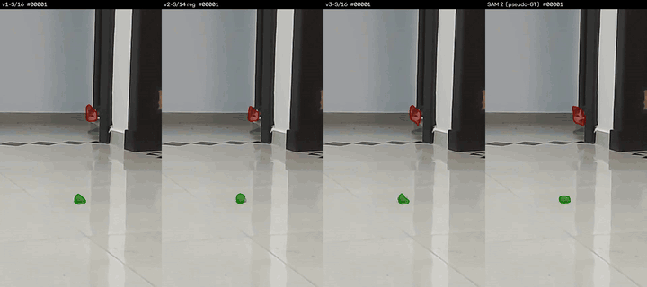
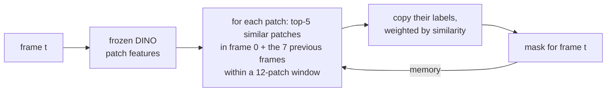
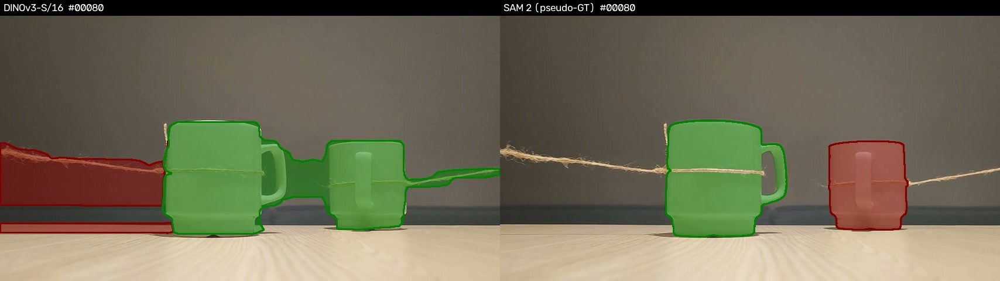

# Tracking objects in video with frozen DINO features (v1, v2, v3)

**Benchmark:** [DAVIS 2017](https://davischallenge.org/) semi-supervised video object segmentation (all 30
validation videos), plus 8 of our own phone clips scored against SAM 2.

**Question:** do newer DINO generations track objects better when they are used frozen, with no training? And what
matters more, model size or input resolution?

**Answer:** DINOv3 is about 6 J&F ahead of DINO v1 and DINOv2 at the same size and resolution, and resolution matters
more than size. The best runs are **76.3 J&F** on DAVIS (DINOv3-B at 2x) and **81.0 IoU** against SAM 2 on our clips
(DINOv3-L at 2x).



## The task

- **Input.** A video and the object masks in its first frame.
- **Output.** The masks in every later frame.
- **No training.** The DINO model is frozen. Masks are copied from frame to frame by matching patch features.
- **Metrics.** J&F (region IoU and boundary accuracy) with the official DAVIS toolkit. Our own clips have no ground
  truth, so we score IoU against SAM 2.1, which is a much stronger video tracker. These scores measure agreement with
  SAM 2, not correctness.

## Pipeline



This is label propagation as in the original DINO paper's
[evaluation script](https://github.com/facebookresearch/dino/blob/main/eval_video_segmentation.py). Our DINO v1 run
reproduces the paper exactly (J&F 61.78 vs 61.8).

To keep the comparison fair, every model uses the same settings (top-5, temperature 0.1, 7-frame memory) and sees the
same token grid: 30×52 patches at 1x and 60×104 at 2x. DINO v1 and DINOv3 use 16 px patches and DINOv2 uses 14 px, so
the input image size is adjusted per model.

## Results

### DAVIS 2017 validation (J&F, 30 videos)

| Model | 1x | 1.5x | 2x |
|---|---|---|---|
| DINO v1 ViT-S/16 | 61.8 | | 68.2 |
| DINOv2 ViT-S/14 + registers | 61.4 | | 71.6 |
| DINOv3 ViT-S/16 | 67.9 | 72.8 | 71.8 |
| DINOv3 ViT-S+/16 | 68.9 | 74.3 | 74.6 |
| DINOv3 ViT-B/16 | 69.7 | 75.6 | **76.3** |
| DINOv3 ViT-L/16 | 72.0 | not run | not run |

1x is 480 px on the short side, 1.5x is 720 px and 2x is 960 px.

- **Same size, newer generation:** DINOv3-S is about 6 points ahead of v1 and v2 at 1x.
- **Resolution beats size at equal compute:** DINOv3-S at 1.5x (72.8, 0.18 s per frame) beats DINOv3-L at 1x
  (72.0, 0.31 s per frame).
- **Why DINOv3-S is lower at 2x than at 1.5x:** a few small objects collapse at 2x (the pen in lab-coat drops by 40),
  which pulls the mean down.

### Our own clips (IoU against SAM 2, 8 clips)

DINOv3-L at 2x, per clip:

| Clip | IoU | Clip | IoU |
|---|---|---|---|
| person walk | 96.4 | cup slide | 89.1 |
| zoom in/out | 95.5 | hat + cup | 70.8 |
| mug swing | 94.8 | monstera | 64.7 |
| cup + bottle | 91.8 | twin mugs | 44.9 |

| Run | Mean IoU (8 clips) |
|---|---|
| DINO v1-S, 1x | 72.2 |
| DINOv2-S, 1x | 70.8 |
| DINOv3-S, 1x | 74.7 |
| DINOv3-S, 2x | 78.4 |
| DINOv3-B, 2x | 80.1 |
| DINOv3-L, 2x | **81.0** |

## What we found

1. **Resolution beats model size.** Going from 1x to 2x adds 5–9 IoU for every model. Going from DINOv3-S to L adds
   less than 3.
2. **Identical objects fool every model.** After two identical mugs cross, 90–100% of the rear mug takes the front
   mug's label. This happens for every generation and size, with or without the search window. SAM 2 keeps them apart.

   
3. **DINOv3 keeps look-alikes apart if they are not identical.** On two similar monstera leaves, DINO v1 labels 56% of
   one leaf as the other. DINOv2 does this for 9% and DINOv3 for 0%.
4. **Uncovered background keeps the label.** When an object moves, the wall revealed behind it can inherit the object's
   label, and the error grows over time. On a zoom-out clip at 2x, the IoU is 79 for DINOv3-S, 88 for B and 94 for L.
   This is where a bigger model clearly helps.
5. **Parts that are not visible in frame 0 are hard.** A leaf unfolding from behind another leaf has no labelled patch
   to copy its label from. The same goes for a cat that starts as only a head behind a door.

**Where it is useful:** following unusual objects (plants, lab footage, animals) without any training data, speeding up
video annotation (propagate, then fix), and choosing a backbone for dense tasks.

**Where it is not:** many identical objects, objects that leave and come back somewhere else, and long videos with a
moving camera. Those need a real tracker such as SAM 2.

Full working notes, ablations (window size, padding, memory) and the diagnosis of each failure are in
[NOTES.md](NOTES.md).

## Try it on your own video

```bash
python track.py
```

1. A file dialog opens: pick a video.
2. The first frame opens. Click on each object you want to track, and SAM 2 turns the clicks into a mask.
   - left click: this is the object; right click: this is *not* the object
   - `n` next object, `u` undo, `r` clear the object, `q` done (saves)
3. Check the first-frame masks: `Enter` / `y` to continue, `e` to edit again, `q` to quit.
4. Check the masks on the whole video. SAM 2 tracks your masks through the clip (about 0.5 s per frame on a GPU), and
   a player opens.
   - `space` play / pause, `a` / `d` or the arrow keys to step, slider to jump
   - `Enter` / `y` to run DINO, `e` to go back to the clicks, `q` to quit
5. DINO tracks the masks through the video. You get an MP4 and a GIF in `outputs/<video name>/`.

`--no_preview` skips step 4.

```bash
python track.py my_clip.mp4 --model v3-s16 --scale 1.5        # the defaults
python track.py my_clip.mp4 --model v3-l16 --scale 2          # best quality, much slower
python track.py my_clip.mp4 --start 2 --duration 5 --fps 15   # trim first
```

`--scale` sets the input resolution. Try a higher scale before a bigger model. Short clips (5–10 s, under about 300
frames) work best.

## Files

| File | What it does |
|---|---|
| `track.py` | Interactive tool: pick a video, click the objects, check the masks, track, get an MP4 and a GIF. |
| `vos/features.py` | Patch features for every model (DINO v1 via `torch.hub`, DINOv2 and DINOv3 via Hugging Face). |
| `vos/propagate.py` | Label propagation, with the same maths as the original DINO script. |
| `vos/cache.py` | Optional fp16 feature cache for repeated DAVIS runs. |
| `run_davis.py`, `make_table.py` | DAVIS runs and the results table. |
| `scripts/run_p0_p1.sh` | The batch of DAVIS runs behind the table above. |
| `clip_tool.py` | Own clips: extract frames, click masks, SAM 2 reference (with correction clicks). |
| `eval_custom.py`, `make_video.py` | Scores and side-by-side overlay videos for own clips. |
| `tests/` | Equivalence check against the original propagation code, and model loading checks. |
| `results/`, `results_custom/` | Score CSVs of all our runs. |
| `patches/` | The fix for the DAVIS toolkit (see below). |
| `NOTES.md` | Lab notebook: every run, ablation and finding. |

## Running

Tested on Windows 11, Python 3.13, PyTorch 2.10 + CUDA 13.0 with an NVIDIA GPU. GPU memory stays under about 2.5 GB,
even for DINOv3-L at 2x. A CPU works for short clips at 1x but is slow.

```bash
# 1. PyTorch with the CUDA build for your GPU: https://pytorch.org/get-started/locally/
# 2. everything else (includes SAM 2 from GitHub)
pip install -r requirements.txt
# 3. SAM 2.1 small checkpoint, used for the clicks (about 180 MB)
mkdir checkpoints
curl -L -o checkpoints/sam2.1_hiera_small.pt https://dl.fbaipublicfiles.com/segment_anything_2/092824/sam2.1_hiera_small.pt
```

Run everything from this folder.

**DINOv3 weights are gated.** Accept the licence on the Hugging Face model page (for example
[facebook/dinov3-vits16-pretrain-lvd1689m](https://huggingface.co/facebook/dinov3-vits16-pretrain-lvd1689m)), then run
`hf auth login`. Without that, use `--model v2r-s14` (DINOv2) or `--model v1-s16` (DINO v1), which need no login.
Weights download on first use.

### Reproducing the DAVIS results

```bash
# DAVIS 2017 (semi-supervised, 480p) into data/DAVIS
curl -L -o DAVIS.zip https://data.vision.ee.ethz.ch/csergi/share/davis/DAVIS-2017-trainval-480p.zip
# unzip so that data/DAVIS/JPEGImages/480p/... exists

# DAVIS evaluation toolkit, patched for NumPy 2 and Windows paths
git clone https://github.com/davisvideochallenge/davis2017-evaluation third_party/davis2017-evaluation
git -C third_party/davis2017-evaluation apply ../../patches/davis2017-evaluation.patch
pip install -e third_party/davis2017-evaluation

# optional: local copy of DINO v1 (otherwise torch.hub fetches it from GitHub)
git clone https://github.com/facebookresearch/dino third_party/dino

# one model, several resolutions; appends to results/summary.csv
python run_davis.py --model v3-s16 --scale 1 1.5 2
python make_table.py
```

Without the toolkit patch, Windows users get J&F = 100, because the evaluator scores the ground truth against itself.

### Own clips

```bash
python clip_tool.py extract my_clip.mp4 --name my-clip          # frames into data/custom
python clip_tool.py annotate my-clip                            # first-frame mask with SAM 2 clicks
python clip_tool.py propagate my-clip                           # SAM 2 reference for every frame
python run_davis.py --model v3-s16 --scale 1 2 --data data/custom --dataset custom \
    --seq_list data/custom/ImageSets/custom.txt --results results_custom --no_eval
python eval_custom.py                                           # IoU, swap rate, identity confusion
python make_video.py --data data/custom --results results_custom --seq my-clip \
    --runs v1-s16_1x v2r-s14_1x v3-s16_1x --ref sam2            # side-by-side overlay video
```

The datasets, our phone clips, model weights and rendered videos are git-ignored.

## Credits

[DINO](https://github.com/facebookresearch/dino), [DINOv2](https://github.com/facebookresearch/dinov2),
[DINOv3](https://github.com/facebookresearch/dinov3), [SAM 2](https://github.com/facebookresearch/sam2) and the
[DAVIS](https://davischallenge.org/) benchmark. Model weights keep their own licences. DINOv3 in particular has its own
licence terms on Hugging Face.
