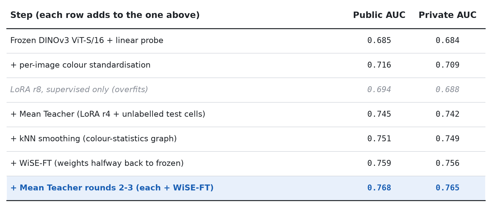

# Oral cancer cell classification with DINOv3

**Challenge:** [Multimodal Cancer Classification Challenge 2026 (Kaggle)](https://www.kaggle.com/competitions/multimodal-cancer-classification-challenge-2026)

**Question:** how far can we get on this task using only DINOv3?

**Answer:** from 0.685 with frozen DINO to **0.768 public / 0.765 private AUC**.

## The task

- **Data.** Each sample is one oral cytology cell imaged twice, in brightfield (BF) and fluorescence (FL), both 128 × 128 px.
- **Training labels.** There are 12 labelled patients: 5 with cancer and 7 healthy. The labels are per patient, so every
  cell of a cancer patient counts as "cancer", even though most of those cells look normal.
- **Test set.** About 59,000 cells from about 7 unseen patients. We don't know which cell belongs to which patient.
- **Metric.** AUC pooled over all test cells.

The hard part is the weak labels. We have to score single cells, but the labels only describe whole patients.

## Pipeline

Training runs in three rounds of Mean Teacher. Each round starts from the previous round's model after WiSE-FT.

## Results (each row adds to the one above)

| Step | Public | Private |
|---|---|---|
| Frozen DINO + linear probe | 0.685 | 0.684 |
| + per-image colour standardisation | 0.716 | 0.709 |
| + Mean Teacher (LoRA r4) | 0.745 | 0.742 |
| + kNN smoothing | 0.751 | 0.749 |
| + WiSE-FT | 0.759 | 0.756 |
| + Mean Teacher rounds 2–3 (each + WiSE-FT) | **0.768** | **0.765** |

All 26 Kaggle submissions and the validation runs are in [results/experiments.xlsx](results/experiments.xlsx). The full
log is in [results/RESULTS_log.md](results/RESULTS_log.md).

## The techniques, in simple terms

**Frozen DINO + linear probe.** DINOv3 turns each image into a feature vector and is not trained at all. For each
modality we take the CLS token plus the mean of the 64 patch tokens. A 128 px image cut into 16 px patches gives
8 × 8 = 64 patches. BF and FL together give a 1536-d vector, and a balanced logistic regression is trained on it.

**Per-image standardisation.** Before DINO, every image is rescaled to mean 0 and standard deviation 1 per colour
channel. This removes brightness and stain differences between patients, which otherwise act as shortcuts.

**LoRA.** Instead of changing DINO's weights directly, LoRA adds a small trainable update next to them. Here it is
rank 4, on the attention layers (qkv and proj) of the last 6 blocks, about 55k parameters. Trained only on the 12
labelled patients, it overfits (0.694, worse than frozen).

**Mean Teacher** uses the unlabelled test cells as well:

| | Student | Teacher |
|---|---|---|
| Model | DINO + LoRA + head | same architecture |
| Sees | 64 labelled + 64 test cells per step, **strongly augmented** | the same 64 test cells, **clean** |
| Learns by | gradient descent | slowly copying the student: teacher = 0.999 × teacher + 0.001 × student |

The student's loss has two parts:

- **On labelled cells:** binary cross-entropy against the patient's label.
- **On test cells:** binary cross-entropy against the teacher's soft guess (for example 0.73). This guess is the
  pseudo-label.

The teacher has no loss of its own. The student has to give the same answer on a distorted cell (rotation, crop, blur,
noise, gamma, a hidden modality) as the teacher gives on the clean one. This adapts DINO to the test patients without
their labels. We submit the teacher after 3 epochs.

**kNN smoothing.** We compute 12 colour statistics per cell: the mean and standard deviation of each BF and FL channel.
For each cell we find its 100 most similar cells by these statistics. Its score becomes half its own score plus half the
mean score of those neighbours, repeated 10 times. Similar cells often come from the same patient, so this is a partial
"average per patient".

**WiSE-FT (weight-space ensembling).** After Mean Teacher, we move the model halfway back to the original frozen DINO.
In practice we multiply the LoRA update by 0.5 and average the trained head with the frozen probe's head. The new
weights sit between "general DINO" and "adapted to our data". Averaging the weights works better than averaging the two
models' predictions (0.759 vs 0.751). Adapting further away from frozen DINO kept hurting on new patients, and pulling
it back helped every time.

**Rounds 2–3.** A better model gives better pseudo-labels. So we restarted Mean Teacher from the WiSE-FT model and
applied WiSE-FT again at the end. Round 2 gave +0.006, and round 3 gave +0.003, which is about seed noise.

## What did not work

| Idea | Result | Why |
|---|---|---|
| Middle-layer (layer 5) features | 0.660, **−0.06** | Looked +0.03 better on held-out training patients. It carries stain and texture the 12 training patients share. |
| Bigger model, frozen ViT-B/16 | 0.683, −0.03 | Not a rigorous test: frozen probe only, regularisation not re-tuned, no LoRA, Mean Teacher or WiSE-FT. |
| 224 px input (14 × 14 patches) | 0.702, −0.015 | Upsampling adds no new detail. |
| LoRA rank 2 or 8 instead of 4 | no gain | Rank 8 drifts further from frozen DINO. |
| Token-level BF+FL fusion in one sequence | −0.12 on held-out patients | The model drifts. Late fusion stays. |
| Head-only Mean Teacher | 0.707, worse than frozen | Probably amplified a test patient the probe ranked wrong. |
| Self-supervised adaptation on test cells (no labels) | +0.002 | Without labels it learns augmentation invariance, not cancer. |
| Ensembles of the WiSE models | no gain | After WiSE-FT their rankings correlate at 0.994. |

One thing I learned: held-out training patients misled us three times (layer 5, LoRA rank, head-only Mean Teacher).
After that, the Kaggle leaderboard was the only reliable check. I fixed each submission plan before seeing its score.

## Why it stops around 0.76

From [ceiling_analysis.py](ceiling_analysis.py), on 5 held-out labelled patients:

- **Patients are already ranked correctly.** Averaging the scores per patient gives an AUC of 1.0, so all remaining
  errors are cells inside a patient.
- **The per-cell signal is weak.** Only about 14% of a cancer patient's cells look clearly abnormal.
- **We can't regroup the test cells into patients.** Clustering recovers patients poorly (purity about 0.3).
  kNN smoothing gets part of the way.

So scoring cells one by one hits a ceiling. A bigger backbone alone is unlikely to fix this.

## Files

| File | What it does |
|---|---|
| `mt.py` | Main script: frozen probe, LoRA, Mean Teacher, WiSE-FT (`--load ... --wise 0.5`), later rounds (`--init`). Also has the options for the experiments that failed. |
| `knn_col.py` | kNN smoothing of a submission CSV on the colour-statistics graph. |
| `embed_robust.py` | Frozen features and colour statistics for several input variants. |
| `embed_layers.py`, `layer_tests.py` | Features from layers 5, 8 and 11, and the layer and pooling probe tests. |
| `big_probe.py` | Frozen probe for any DINOv3 size (the ViT-B test). |
| `ceiling_analysis.py` | Why we plateau (the section above). |
| `run_pipeline.sh` | The exact commands for the final submission. |
| `results/` | Results table, all experiments (xlsx), full log. |

## Running

Install `requirements.txt`. Then add the following next to the scripts:

- the Kaggle data in `data/` (from the challenge page; not in this repo);
- Meta's [DINOv3 repo](https://github.com/facebookresearch/dinov3) as `dinov3/`;
- the ViT-S/16 weights as `dinov3_vits16.pth`.

Then run `bash run_pipeline.sh`. I ran everything on one rented RTX 2000 Ada GPU.

The data, weights, checkpoints and prediction files are git-ignored.
